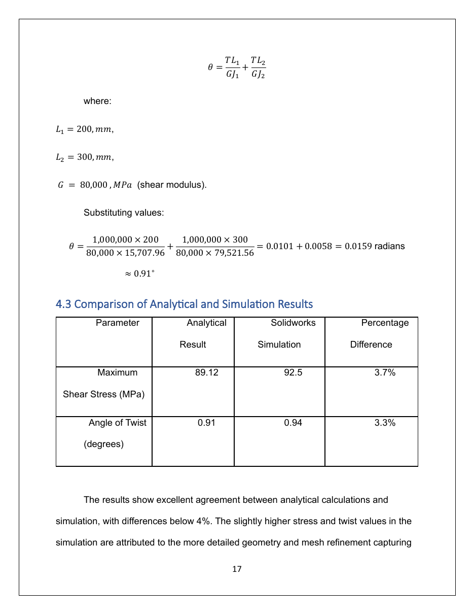
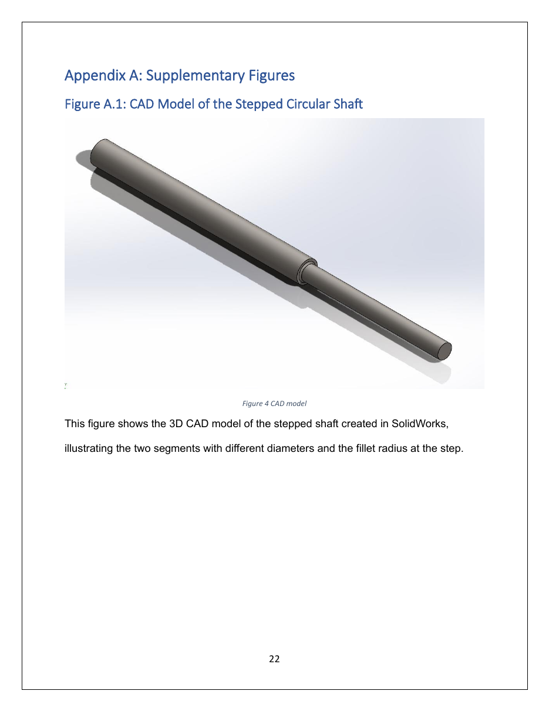
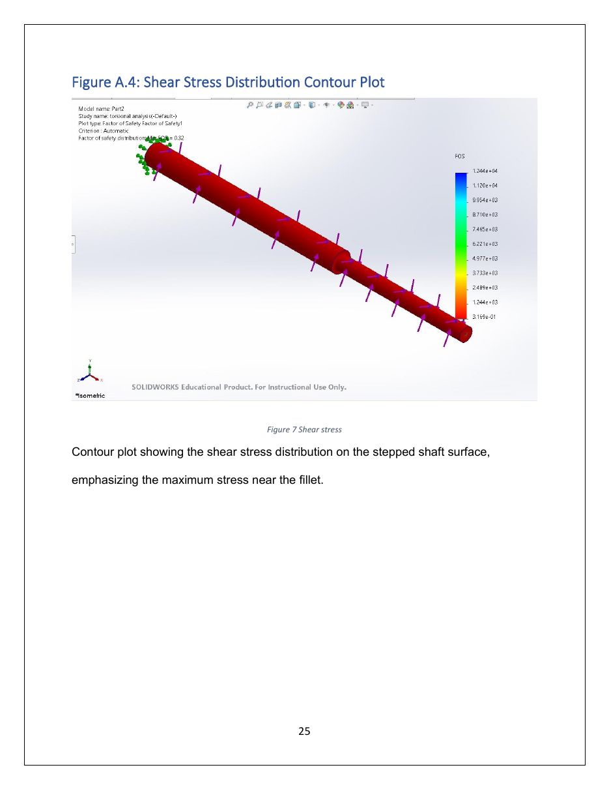

# Stepped Shaft Torsion Analysis

Analytical and finite-element validation of a stepped circular shaft under torsional loading, with emphasis on fillet stress concentration and angular deformation.

<p>
  
  
  
</p>

[Read the complete engineering report](report/stepped-shaft-torsion-analysis-report.pdf)

## Project overview

This project evaluates the torsional response of a two-diameter steel shaft using three complementary engineering methods:

- 3D CAD modeling of the stepped geometry and fillet
- Classical mechanics-of-materials calculations
- Finite-element simulation with local mesh refinement near the stress concentration

The goal was to compare maximum shear stress and total angle of twist, then determine whether the numerical model reproduced the expected analytical behavior.

## Model and loading

| Parameter | Value |
| --- | ---: |
| Smaller shaft segment | 20 mm diameter x 200 mm length |
| Larger shaft segment | 30 mm diameter x 300 mm length |
| Fillet radius | 2 mm |
| Applied torque | 1,000 N.m |
| Material model | Linear-elastic structural steel |
| Shear modulus | 80 GPa |
| Global mesh size | 3 mm |
| Refined fillet mesh | 1 mm |

## Engineering workflow

1. Created the stepped-shaft geometry in SolidWorks.
2. Calculated polar moment of inertia, nominal shear stress, stress-concentration-adjusted peak stress, and segment-by-segment angle of twist.
3. Applied a fixed support at one end and a 1,000 N.m torsional load at the opposite end.
4. Refined the finite-element mesh around the fillet to capture the local stress gradient.
5. Compared simulation outputs against the analytical benchmark.

## Key results

| Result | Analytical | Simulation | Difference |
| --- | ---: | ---: | ---: |
| Maximum shear stress | 89.12 MPa | 92.5 MPa | 3.7% |
| Angle of twist | 0.91 degrees | 0.94 degrees | 3.3% |

- Both validation differences remained below 4%.
- The maximum shear stress occurred at the diameter transition near the fillet.
- The stepped geometry increased local shear stress by approximately 40% relative to the nominal value.
- The result demonstrates why fillet geometry and local mesh refinement matter in drivetrain and rotating-shaft design.



## CAD and simulation evidence

### Stepped-shaft CAD model



### Shear-stress contour



## Skills demonstrated

- Mechanics of materials and classical torsion theory
- SolidWorks CAD modeling
- Finite-element setup, boundary conditions, and mesh refinement
- Stress concentration analysis
- Analytical-to-numerical model validation
- Interpretation and technical communication of engineering results

## Repository contents

```text
.
|-- assets/   Selected CAD, validation, and simulation result pages
|-- report/   Complete 25-page engineering report
`-- README.md Portfolio summary and key results
```

## Scope

This repository is a portfolio archive built from the recovered project report and its embedded visual evidence. Native CAD and simulation source files were not included in the supplied material and can be added later if recovered.
